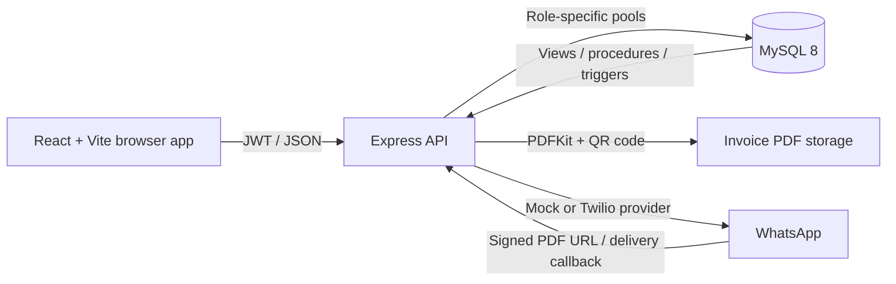

# Ledgerline Billing System

A role-based billing and inventory application for an Indian retail store. Cashiers create invoices and accept split or full payments; customers can view their own bills and loyalty balance; admins manage the catalog, users, stock, reports, and audit history. Paid invoices can be generated as signed PDFs and sent using the mock provider or Twilio WhatsApp.

## Features

- CUSTOMER, CASHIER, and ADMIN login with row-scoped invoice access.
- MySQL 8 stored procedures, triggers, derived-total views, and separate least-privilege database users.
- Product, customer, coupon, stock, invoice, payment, loyalty, reporting, and audit workflows.
- Invoice PDFs with QR verification, signed public PDF links, and ownership-protected downloads.
- Mock or Twilio WhatsApp delivery with status callbacks, retries, and an admin message log.
- Loyalty-tier discounts, an audit timeline, low-stock reorder CSV, and a rollback-only database permissions demo.

## Architecture



## Local prerequisites

- Node.js 18+ and npm. The current Vite 8 frontend tooling requires Node.js 20.19+ (or 22.12+); use one of those versions to run the complete app.
- MySQL Server 8 and its `mysql` command-line client.
- PowerShell on Windows, or a terminal with equivalent commands.

## Manual local setup

1. Start the local MySQL 8 service and create the schema by running the SQL files from the repository root. The first file creates `billing_db`; run the files in order:

   ```powershell
   mysql -u root -p --execute="source database/01_schema.sql"
   mysql -u root -p --execute="source database/02_triggers.sql"
   mysql -u root -p --execute="source database/03_views_procedures.sql"
   mysql -u root -p --execute="source database/04_roles_and_grants.sql"
   mysql -u root -p --execute="source database/05_seed.sql"
   ```

   Or use the root helper, which runs those five scripts in order:

   ```powershell
   Copy-Item .env.example .env
   # Edit .env and set MYSQL_ROOT_PASSWORD and the three DB_*_PASS values.
   npm install
   npm run db:setup
   ```

   `db:setup` assumes a fresh local database. It uses `DB_HOST=localhost` and `DB_PORT=3306` by default, and the example role passwords must match the values in the SQL grants.

2. Copy the backend and frontend environment templates:

   ```powershell
   Copy-Item backend\.env.example backend\.env
   Copy-Item frontend\.env.example frontend\.env
   ```

   Set strong random values for `JWT_SECRET` and `INVOICE_SIGNING_SECRET` in `backend\.env`. Ensure `DB_HOST=localhost`, `DB_PORT=3306`, and the three role passwords match the SQL grants. Keep `WHATSAPP_PROVIDER=mock` for local offline use. The `.env` files are ignored by Git.

3. Install package dependencies:

   ```powershell
   npm ci
   npm --prefix backend ci
   npm --prefix frontend ci
   ```

4. Start the backend and frontend from the repository root:

   ```powershell
   npm run dev
   ```

   Or use separate terminals with `npm run dev:backend` and `npm run dev:frontend`.

5. Open <http://localhost:5173>. The API health check is <http://localhost:4000/health> and Swagger UI is <http://localhost:4000/api-docs/>.

You can also run the individual SQL commands in step 1 without the helper. For database test setup and SQL regression checks, see [database/README.md](./database/README.md).

## Tests, lint, and formatting

```powershell
npm --prefix backend test
npm --prefix backend run lint
npm --prefix frontend run lint
npm --prefix frontend run build
```

Backend tests drop and recreate only `billing_test`; configure `TEST_DB_HOST`, `TEST_DB_PORT`, `TEST_DB_ADMIN_USER`, and `TEST_DB_ADMIN_PASS` in `backend\.env`. Set `MYSQL_CLI_PATH` if the MySQL client is not on `PATH` or in the standard Windows install location.

## Demo accounts

These seeded accounts and passwords are for local demonstration only:

| Role | Username | Password |
| --- | --- | --- |
| ADMIN | `admin` | `Admin@123` |
| CASHIER | `cashier1` | `Cashier@123` |
| CASHIER | `cashier2` | `Cashier@123` |
| CUSTOMER | `priya` | `Customer@123` |
| CUSTOMER | `rahul` | `Customer@123` |

## Environment variables

| Variable | Purpose |
| --- | --- |
| `MYSQL_ROOT_PASSWORD` | Local MySQL administrator password used by `npm run db:setup`. |
| `DB_HOST`, `DB_PORT`, `DB_NAME` | MySQL connection target (`localhost:3306`, `billing_db` by default). |
| `DB_CUSTOMER_USER`, `DB_CUSTOMER_PASS` | Restricted customer database pool. |
| `DB_CASHIER_USER`, `DB_CASHIER_PASS` | Restricted cashier database pool. |
| `DB_ADMIN_USER`, `DB_ADMIN_PASS` | Admin database pool. |
| `JWT_SECRET` | At least 32 random characters for API tokens. |
| `INVOICE_SIGNING_SECRET` | At least 32 random characters for invoice verification and signed PDF HMACs. |
| `CORS_ORIGIN` | Exact frontend origin allowed by CORS. |
| `DEMO_MODE` / `VITE_DEMO_MODE` | Enable the database-permissions demo API and its UI link/buttons. |
| `WHATSAPP_PROVIDER` | `mock` for offline testing or `twilio` for WhatsApp delivery. |
| `PUBLIC_BASE_URL` | Publicly reachable API base URL used for signed PDFs and Twilio status callbacks. |
| `PUBLIC_APP_URL` | Frontend base URL embedded in the invoice verification QR. |
| `UPI_ID` | Optional UPI payee ID; the payment QR is included when an invoice has a balance. |
| `SHOP_NAME`, `SHOP_ADDRESS`, `SHOP_GSTIN` | Invoice header and message details. |
| `TWILIO_ACCOUNT_SID`, `TWILIO_AUTH_TOKEN`, `TWILIO_WHATSAPP_FROM` | Twilio credentials and WhatsApp sandbox sender; see Twilio setup below. |
| `VITE_API_URL`, `VITE_DEMO_MODE` | Frontend API URL and demo UI gate. |

The test runner also reads `TEST_DB_HOST`, `TEST_DB_PORT`, `TEST_DB_ADMIN_USER`, `TEST_DB_ADMIN_PASS`, and `MYSQL_CLI_PATH`.

## Optional real WhatsApp setup with Twilio

The app runs locally in mock mode without any Twilio account or credentials. For real sandbox delivery:

1. Create a free Twilio account and verify your phone number.
2. In the Twilio Console, open **Messaging → Try it out → Send a WhatsApp message** (WhatsApp Sandbox). Note the sandbox WhatsApp number and the exact `join <code>` message shown there.
3. Send that `join <code>` message from your own WhatsApp phone and from any other demo phone that should receive a message. Sandbox membership expires after 72 hours; re-send the join message before the demo.
4. Find the Account SID and Auth Token in the Twilio Console dashboard. In `backend\.env`, set:

   ```dotenv
   TWILIO_ACCOUNT_SID=your_account_sid
   TWILIO_AUTH_TOKEN=your_auth_token
   TWILIO_WHATSAPP_FROM=whatsapp:+14155238886
   WHATSAPP_PROVIDER=twilio
   ```

   Replace the example sender with the sandbox number displayed in your Twilio Console. Keep the SID and token in `backend\.env`; never paste them into chat or commit them.

5. Install ngrok and run it against the backend port:

   ```powershell
   ngrok http 4000
   ```

   Copy the current HTTPS forwarding URL into `PUBLIC_BASE_URL` in `backend\.env`. The free ngrok URL changes after every restart, so update this setting and restart the backend whenever it changes.

6. In the WhatsApp Sandbox settings in Twilio, set the status callback URL to `https://<current-ngrok-host>/api/webhooks/twilio/status`.
7. For a demo message to your phone, update the seeded opted-in customer Priya's phone in MySQL to your own `+91` number:

   ```sql
   UPDATE customers
   SET phone = '+91XXXXXXXXXX'
   WHERE customer_id = 1;
   ```

   Replace `+91XXXXXXXXXX` with your verified WhatsApp number. This update preserves the seeded customer's WhatsApp opt-in.

Keep `WHATSAPP_PROVIDER=mock` as a fallback if the sandbox or ngrok URL is unavailable. See [docs/demo-script.md](./docs/demo-script.md) for the pre-demo checklist.

## Troubleshooting

- **MySQL is not running:** start the MySQL 8 service, then retry. Confirm it listens on port 3306 (or set `DB_PORT` to the port you use).
- **Wrong database credentials / `Access denied`:** compare `DB_*_PASS` in `backend\.env` with the values used by `database/04_roles_and_grants.sql`. For existing DB users, update their MySQL passwords or recreate the local schema and apply the SQL scripts again; changing the example file alone does not change existing users.
- **A port is already in use:** stop the process using port 4000 or 5173, or set the API `PORT` and update `VITE_API_URL` / `CORS_ORIGIN` to match.
- **CORS errors:** set `CORS_ORIGIN` in `backend\.env` to the exact frontend origin, including scheme and port, then restart the backend.
- **`npm test` cannot find MySQL:** add the MySQL `bin` directory to `PATH` or set `MYSQL_CLI_PATH`; the test runner uses the configured isolated test database settings.
- **WhatsApp remains failed/queued:** use `mock` to validate the app offline; for Twilio confirm sandbox membership, credentials, the current HTTPS URL, and that `PUBLIC_BASE_URL` was updated after an ngrok restart.
- **A WhatsApp status callback is rejected:** set `PUBLIC_BASE_URL` to the exact public API origin Twilio calls; callback signatures are checked when `TWILIO_AUTH_TOKEN` is configured.
- **PDF verification fails on a different device:** set `PUBLIC_APP_URL` to the externally reachable frontend URL before generating the PDF.
