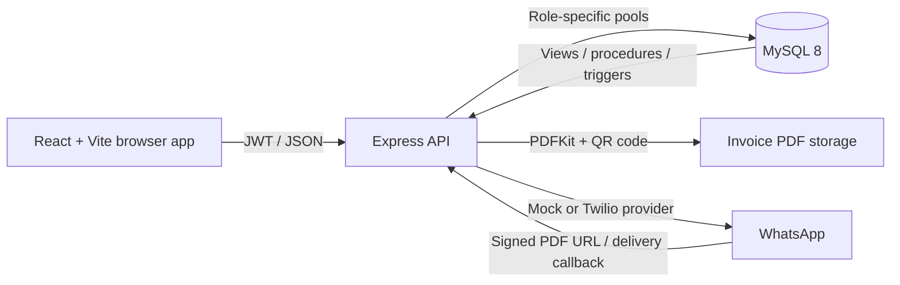

# Ledgerline Billing System

A role-based billing and inventory application for an Indian retail store. Cashiers create invoices and accept split or full payments; customers can view their own bills and loyalty balance; admins manage the catalog, users, stock, reports, and audit history. Paid invoices can be generated as signed PDFs and sent using the mock provider or Twilio WhatsApp.

## Features

- CUSTOMER, CASHIER, and ADMIN login with row-scoped invoice access.
- MySQL 8 stored procedures, triggers, derived-total views, and separate least-privilege DB users.
- Product, customer, coupon, stock, invoice, payment, loyalty, reporting, and audit workflows.
- Invoice PDFs with QR verification, signed public PDF links, and ownership-protected downloads.
- Mock or Twilio WhatsApp delivery with status callbacks, retries, and an admin message log.
- Loyalty-tier discounts, an audit timeline, low-stock reorder CSV, and a rollback-only DB permissions demo.

## Architecture



## Prerequisites

Choose either the Docker path or the local path:

- **Docker:** Docker Engine and Docker Compose v2.
- **Local:** Node.js 24 or later, npm, MySQL 8.0, and the MySQL `mysql` command-line client.

## Run with Docker Compose

From the repository root in PowerShell:

```powershell
Copy-Item .env.example .env
```

Edit `.env` before starting: replace `MYSQL_ROOT_PASSWORD`, `JWT_SECRET`, and `INVOICE_SIGNING_SECRET` with local random values. The three `DB_*_PASS` values in the example deliberately match the demo grants in `database/04_roles_and_grants.sql`; if you change them, update that SQL script to match.

```powershell
docker compose up --build
```

The first MySQL startup creates the schema, triggers, views, procedures, role grants, and seed data. The backend waits for MySQL's health check; the frontend waits for the backend's health check.

| Service | URL / host port |
| --- | --- |
| Frontend | <http://localhost:5173> |
| API health | <http://localhost:4000/health> |
| Swagger UI | <http://localhost:4000/api-docs/> |
| MySQL | `127.0.0.1:3307` |

Useful commands:

```powershell
docker compose ps
docker compose logs -f backend
docker compose down
```

The named MySQL and invoice-storage volumes persist across `docker compose down`. **`docker compose down -v` permanently deletes that Compose project's database and generated PDFs.** Use it only when you intentionally want a fresh demo.

Host ports can be changed in `.env` (`MYSQL_PORT`, `API_PORT`, `FRONTEND_PORT`); keep `VITE_API_URL`, `CORS_ORIGIN`, `PUBLIC_BASE_URL`, and `PUBLIC_APP_URL` consistent with the selected host ports.

## Run locally without Docker

1. Create a MySQL 8 database and the three application users using the SQL files, in order. The scripts and upgrade instructions are in [database/README.md](./database/README.md). The credentials in `backend/.env.example` must match the values used by `database/04_roles_and_grants.sql`.
2. Configure the backend:

   ```powershell
   Copy-Item backend\.env.example backend\.env
   ```

   Set strong random values for `JWT_SECRET` and `INVOICE_SIGNING_SECRET`; set `DB_HOST`, `DB_PORT`, and the DB-role passwords to match MySQL. Keep `DEMO_MODE=true` for the demo-only DB permissions page.
3. Install and start the API in one terminal:

   ```powershell
   Set-Location backend
   npm ci
   npm start
   ```

4. Install and start the frontend in another terminal:

   ```powershell
   Set-Location frontend
   npm ci
   npm run dev
   ```

5. Open <http://localhost:5173>. The frontend's default API URL is `http://localhost:4000/api`.

### Tests, lint, and formatting

Run from each package directory:

```powershell
Set-Location backend
npm test
npm run lint
npm run format:check
```

`npm test` **drops and recreates only `billing_test`**, initializes it from the SQL scripts, runs `database/tests.sql`, then runs Jest against that isolated database. It requires a privileged test-setup MySQL account. Set `TEST_DB_HOST`, `TEST_DB_PORT`, `TEST_DB_ADMIN_USER`, and `TEST_DB_ADMIN_PASS` in `backend/.env`; set `MYSQL_CLI_PATH` if `mysql` is not on `PATH` or in the standard Windows install location.

```powershell
Set-Location frontend
npm run lint
npm run format:check
npm run build
```

`npm run format` formats the package source. Lint and format commands do not change files.

## Demo accounts

These seeded accounts and passwords are for local demonstration only:

| Role | Username | Password |
| --- | --- | --- |
| ADMIN | `admin` | `Admin@123` |
| CASHIER | `cashier1` | `Cashier@123` |
| CASHIER | `cashier2` | `Cashier@123` |
| CUSTOMER | `priya` | `Customer@123` |
| CUSTOMER | `rahul` | `Customer@123` |

## Environment variables

| Variable | Purpose |
| --- | --- |
| `JWT_SECRET` | At least 32 random characters for API tokens. |
| `INVOICE_SIGNING_SECRET` | At least 32 random characters for invoice verification and signed PDF HMACs. |
| `DB_HOST`, `DB_PORT`, `DB_NAME` | MySQL connection target (`billing_db` in normal operation). |
| `DB_CUSTOMER_USER`, `DB_CUSTOMER_PASS` | Restricted customer DB pool. |
| `DB_CASHIER_USER`, `DB_CASHIER_PASS` | Restricted cashier DB pool. |
| `DB_ADMIN_USER`, `DB_ADMIN_PASS` | Admin DB pool. |
| `CORS_ORIGIN` | Exact frontend origin allowed by CORS. |
| `DEMO_MODE` / `VITE_DEMO_MODE` | Enable the database-permissions demo API and its UI link/buttons. |
| `WHATSAPP_PROVIDER` | `mock` for offline testing or `twilio` for WhatsApp delivery. |
| `PUBLIC_BASE_URL` | Publicly reachable API base URL used for signed PDFs and Twilio status callbacks. |
| `PUBLIC_APP_URL` | Frontend base URL embedded in the invoice verification QR. |
| `UPI_ID` | Optional UPI payee ID; the payment QR is included when an invoice has a balance. |
| `SHOP_NAME`, `SHOP_ADDRESS`, `SHOP_GSTIN` | Invoice header and message details. |
| `TWILIO_ACCOUNT_SID`, `TWILIO_AUTH_TOKEN`, `TWILIO_WHATSAPP_FROM` | Twilio WhatsApp credentials and sender. |
| `VITE_API_URL`, `VITE_DEMO_MODE` | Frontend API URL and demo UI gate. |

The test runner also reads `TEST_DB_HOST`, `TEST_DB_PORT`, `TEST_DB_ADMIN_USER`, `TEST_DB_ADMIN_PASS`, and `MYSQL_CLI_PATH`.

## Twilio WhatsApp sandbox

Mock delivery is the default and requires no external service. To try Twilio:

1. Create a Twilio account, enable the WhatsApp Sandbox, and join the sandbox from the test handset using the `join <code>` message shown in the Twilio console. Use the sender number displayed in that console.
2. Start public HTTPS tunnels for the API and frontend. For local services on their default ports, use two terminals:

   ```powershell
   ngrok http 4000
   ngrok http 5173
   ```

3. Set the following in the backend environment and restart it:
   - `TWILIO_ACCOUNT_SID`, `TWILIO_AUTH_TOKEN`, and `TWILIO_WHATSAPP_FROM=whatsapp:<sandbox-number>`.
   - `WHATSAPP_PROVIDER=twilio`.
   - `PUBLIC_BASE_URL=https://<api-tunnel>` and `PUBLIC_APP_URL=https://<frontend-tunnel>`.
   - `CORS_ORIGIN=https://<frontend-tunnel>`.
4. Set `VITE_API_URL=https://<api-tunnel>/api`, restart/rebuild the frontend, and create a paid invoice for a customer who opted in and has the joined WhatsApp phone number.
5. Twilio receives the status callback at `POST /api/webhooks/twilio/status`; the provider attaches this callback to outgoing messages. Twilio fetches the invoice media from the signed PDF URL on the API tunnel. Signed links expire after 30 minutes.

Keep credentials in ignored `.env` files, never in source or screenshots. Twilio sandbox delivery needs a joined handset and public tunnels; if unavailable, follow the mock fallback in [docs/demo-script.md](./docs/demo-script.md).

## Troubleshooting

- **`Access denied` on database startup:** confirm the password in `backend/.env` matches the user created by `database/04_roles_and_grants.sql`; re-run the grant script after rebuilding stored procedures.
- **API cannot connect to MySQL:** local mode uses `DB_HOST=127.0.0.1`; Compose mode must use `DB_HOST=mysql`. Confirm the configured port and that all three DB role accounts exist.
- **`npm test` cannot find MySQL:** add the MySQL `bin` directory to `PATH` or set `MYSQL_CLI_PATH`. The test runner connects to the configured test setup port and recreates only `billing_test`.
- **Docker backend fails immediately:** wait for MySQL initialization to finish, inspect `docker compose logs mysql backend`, and check that the JWT/signing secrets and three role passwords are present in `.env`.
- **WhatsApp remains failed/queued:** use `mock` to validate the app offline; for Twilio confirm sandbox membership, opt-in, HTTPS tunnel URLs, credentials, and the signed-media API URL.
- **A WhatsApp status callback is rejected:** set `PUBLIC_BASE_URL` to the exact public API origin Twilio calls; the callback signature is checked when `TWILIO_AUTH_TOKEN` is configured.
- **PDF verification fails on a different device:** set `PUBLIC_APP_URL` to the externally reachable frontend URL before generating the PDF.
