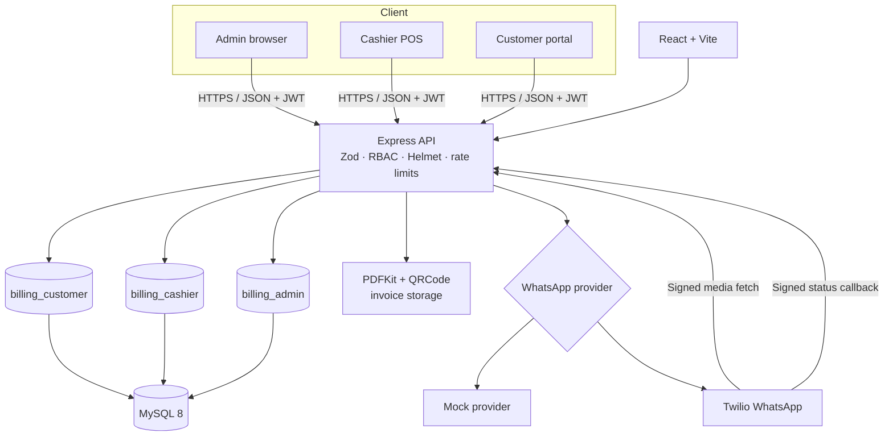
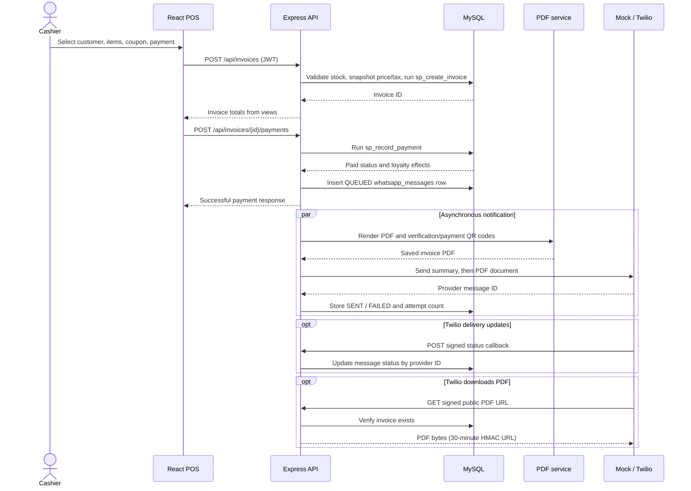

# Architecture

## Components

## Create bill to WhatsApp data flow

Payment completion does not wait for WhatsApp delivery. The notification runs after the payment and stores its own queue, retry, and final-status state.

## Why separate database users

The API chooses a MySQL pool based on the authenticated role. `billing_customer` can read customer-facing invoice data and update only the allowed profile columns; `billing_cashier` can search catalog data, create invoices and payments through stored procedures, and send notifications, but cannot change prices or delete products; `billing_admin` can manage the full schema. Express authorization and row-scoped queries provide application-level checks, while MySQL grants provide an independent database boundary if an application check is bypassed. Totals are computed in views rather than stored, and invoice-item price/tax fields preserve the sale-time snapshot.
